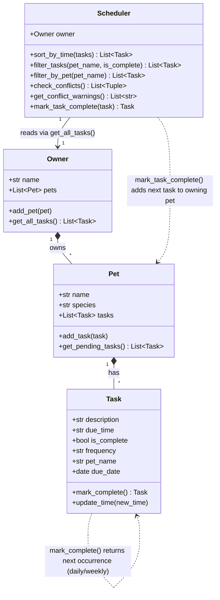
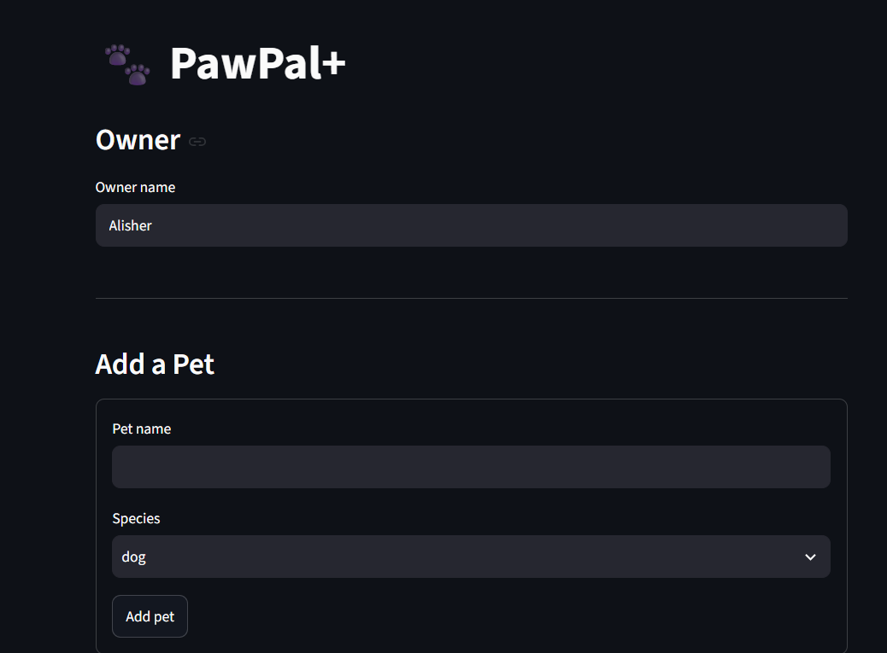
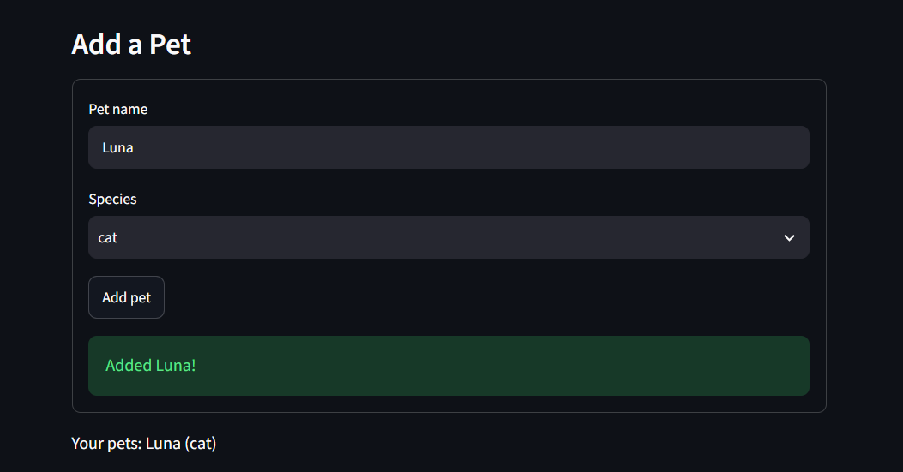
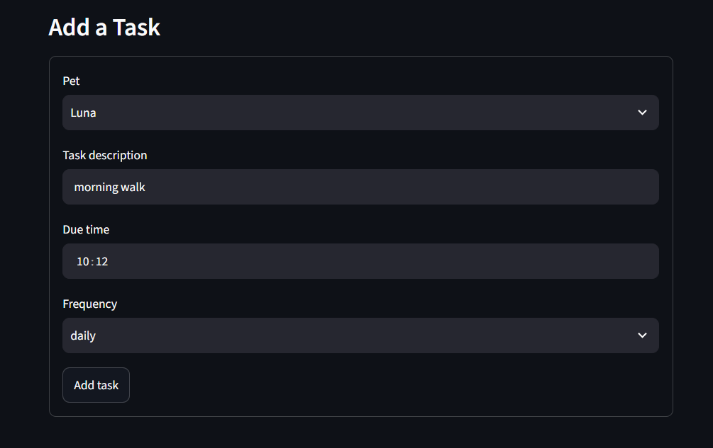
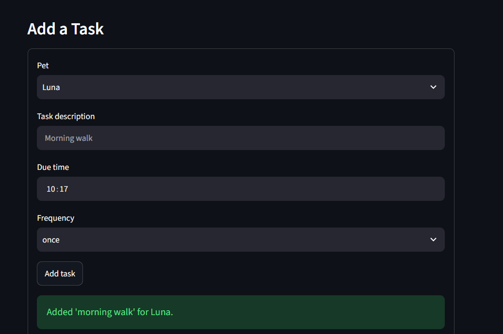
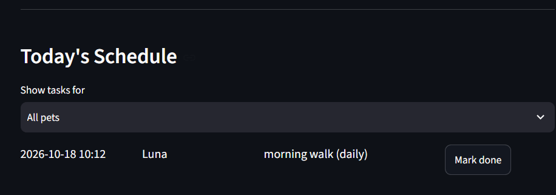
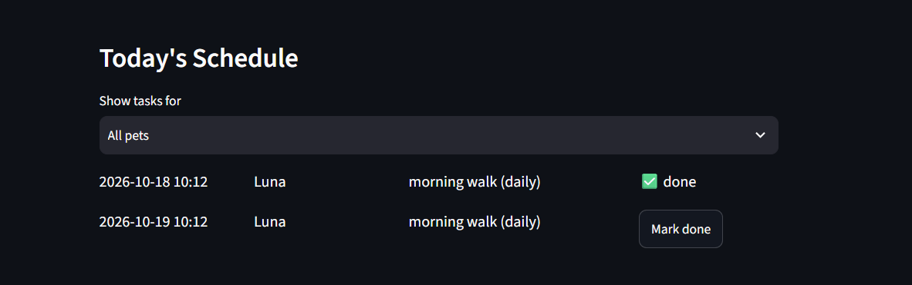
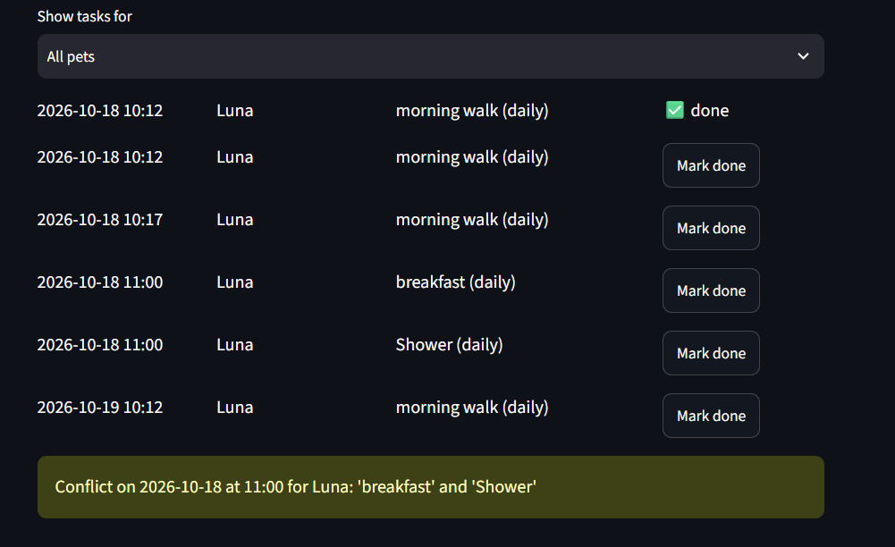

# PawPal+ (Module 2 Project)

You are building **PawPal+**, a Streamlit app that helps a pet owner plan care tasks for their pet.

## Scenario

A busy pet owner needs help staying consistent with pet care. They want an assistant that can:

- Track pet care tasks (walks, feeding, meds, enrichment, grooming, etc.)
- Consider constraints (time available, priority, owner preferences)
- Produce a daily plan and explain why it chose that plan

Your job is to design the system first (UML), then implement the logic in Python, then connect it to the Streamlit UI.

## What you will build

Your final app should:

- Let a user enter basic owner + pet info
- Let a user add/edit tasks (duration + priority at minimum)
- Generate a daily schedule/plan based on constraints and priorities
- Display the plan clearly (and ideally explain the reasoning)
- Include tests for the most important scheduling behaviors

## Implementation summary

The logic layer lives in `pawpal_system.py` and has four classes:

- **`Task`** (dataclass): one care activity with a description, `"HH:MM"` due time, frequency, completion flag and the name of the pet it belongs to.
- **`Pet`** (dataclass): a pet's name, species and list of tasks. `add_task()` attaches a task and stamps it with the pet's name.
- **`Owner`** (dataclass): holds the list of pets. `get_all_tasks()` returns every pet's tasks in one list.
- **`Scheduler`**: takes an `Owner` and always reads tasks through `owner.get_all_tasks()`, so it works across all pets. It sorts tasks by time, filters by pet name, and reports tasks that share a time.

Data flows `Owner -> Pet -> Task`, and the `Scheduler` sits on top, reading from the `Owner`. `main.py` is a terminal demo, and `tests/test_pawpal.py` holds the first automated tests (`python -m pytest`).

## Features

- **Multi-pet management:** an owner can have any number of pets, each with its own tasks (`Owner.add_pet()`, `Pet.add_task()`).
- **Sorting by time:** tasks from all pets are ordered by date, then `HH:MM` time (`Scheduler.sort_by_time()`).
- **Filtering:** by pet name, by completion status, or both (`Scheduler.filter_tasks()`).
- **Conflict warnings:** tasks at the same date and time are flagged, for one pet or across pets, as readable warnings instead of errors (`Scheduler.get_conflict_warnings()`).
- **Daily and weekly recurrence:** completing a recurring task creates the next occurrence, one or seven days later (`Scheduler.mark_task_complete()`).
- **Streamlit UI:** forms for adding pets and tasks, a sorted and filterable schedule, summary counts, conflict warnings and a "Mark done" button. State is kept in `st.session_state`.
- **Tests:** 17 automated tests (`python -m pytest`).

## Architecture

The final UML is in [`diagrams/uml_final.mmd`](diagrams/uml_final.mmd) (the original draft is `diagrams/uml.mmd`).



## Getting started

### Setup

```bash
python -m venv .venv
source .venv/bin/activate  # Windows: .venv\Scripts\activate
pip install -r requirements.txt
```

### Suggested workflow

1. Read the scenario carefully and identify requirements and edge cases.
2. Draft a UML diagram (classes, attributes, methods, relationships).
3. Convert UML into Python class stubs (no logic yet).
4. Implement scheduling logic in small increments.
5. Add tests to verify key behaviors.
6. Connect your logic to the Streamlit UI in `app.py`.
7. Refine UML so it matches what you actually built.

## 🖥️ Sample Output

Output of `python main.py`, which adds tasks out of order, then sorts, filters, flags conflicts and completes recurring tasks:

```
All tasks as added (unsorted)
----------------------------------------------------------
Date        Time   Pet      Task                Repeats Status
2026-10-18  18:30  Mochi    Evening walk        daily   pending
2026-10-18  08:00  Mochi    Morning walk        daily   pending
2026-10-18  12:15  Luna     Medication          weekly  pending
2026-10-18  08:00  Luna     Breakfast           once    pending
2026-10-18  08:00  Luna     Grooming            once    pending

Sorted by time
----------------------------------------------------------
Date        Time   Pet      Task                Repeats Status
2026-10-18  08:00  Mochi    Morning walk        daily   pending
2026-10-18  08:00  Luna     Breakfast           once    pending
2026-10-18  08:00  Luna     Grooming            once    pending
2026-10-18  12:15  Luna     Medication          weekly  pending
2026-10-18  18:30  Mochi    Evening walk        daily   pending

Filter: Luna only
----------------------------------------------------------
Date        Time   Pet      Task                Repeats Status
2026-10-18  12:15  Luna     Medication          weekly  pending
2026-10-18  08:00  Luna     Breakfast           once    pending
2026-10-18  08:00  Luna     Grooming            once    pending

Conflict warnings
----------------------------------------------------------
Conflict on 2026-10-18 at 08:00 between Mochi and Luna: 'Morning walk' and 'Breakfast'
Conflict on 2026-10-18 at 08:00 between Mochi and Luna: 'Morning walk' and 'Grooming'
Conflict on 2026-10-18 at 08:00 for Luna: 'Breakfast' and 'Grooming'

Completing Mochi's daily morning walk and Luna's weekly medication...
  Morning walk: next occurrence on 2026-10-19
  Medication: next occurrence on 2026-10-25

Filter: pending only
----------------------------------------------------------
Date        Time   Pet      Task                Repeats Status
2026-10-18  08:00  Luna     Breakfast           once    pending
2026-10-18  08:00  Luna     Grooming            once    pending
2026-10-18  18:30  Mochi    Evening walk        daily   pending
2026-10-19  08:00  Mochi    Morning walk        daily   pending
2026-10-25  12:15  Luna     Medication          weekly  pending

Filter: completed only
----------------------------------------------------------
Date        Time   Pet      Task                Repeats Status
2026-10-18  08:00  Mochi    Morning walk        daily   done
2026-10-18  12:15  Luna     Medication          weekly  done
```

## 🧪 Testing PawPal+

```bash
python -m pytest
```

The 17 tests in `tests/test_pawpal.py` cover:

- **Basics:** `Task.mark_complete()` changes status, and `Pet.add_task()` increases the task count.
- **Sorting:** tasks from several pets come back in chronological order, date sorts before time, and tasks with identical times keep their insertion order.
- **Filtering:** by pet name (case-insensitive), by completion status, and by both.
- **Recurrence:** completing a daily task creates one for the next day and a weekly task one for seven days later. Month and year rollovers are handled. "once" tasks don't recur. Completing the same task twice doesn't create a duplicate.
- **Conflict detection:** same-time tasks are flagged for one pet or across pets, three tasks at one time give three pairs, and tasks on different dates or already completed are ignored.
- **Edge cases:** an owner with no pets, a pet with no tasks, and completing a task that belongs to no pet (raises `ValueError` and changes nothing).

Test output:

```
============================= test session starts =============================
platform win32 -- Python 3.14.3, pytest-9.1.1, pluggy-1.7.0
collecting ... collected 17 items

tests/test_pawpal.py::test_mark_complete_changes_status PASSED           [  5%]
tests/test_pawpal.py::test_add_task_increases_pet_task_count PASSED      [ 11%]
tests/test_pawpal.py::test_sort_by_time_orders_tasks_across_pets PASSED  [ 17%]
tests/test_pawpal.py::test_filter_tasks_by_pet_and_status PASSED         [ 23%]
tests/test_pawpal.py::test_completing_daily_task_creates_next_day_occurrence PASSED [ 29%]
tests/test_pawpal.py::test_completing_weekly_task_adds_seven_days_and_once_task_does_not_recur PASSED [ 35%]
tests/test_pawpal.py::test_conflict_detection_warns_for_same_slot_only PASSED [ 41%]
tests/test_pawpal.py::test_conflict_ignores_other_dates_and_completed_tasks PASSED [ 47%]
tests/test_pawpal.py::test_pet_and_owner_with_no_tasks PASSED            [ 52%]
tests/test_pawpal.py::test_owner_with_no_pets_does_not_crash PASSED      [ 58%]
tests/test_pawpal.py::test_sort_by_time_orders_by_date_before_time PASSED [ 64%]
tests/test_pawpal.py::test_sort_keeps_insertion_order_for_identical_times PASSED [ 70%]
tests/test_pawpal.py::test_three_tasks_at_same_time_give_three_conflict_pairs PASSED [ 76%]
tests/test_pawpal.py::test_same_pet_conflict_message_names_the_pet_once PASSED [ 82%]
tests/test_pawpal.py::test_completing_a_task_twice_does_not_duplicate_next_occurrence PASSED [ 88%]
tests/test_pawpal.py::test_completing_task_that_belongs_to_no_pet_raises_and_changes_nothing PASSED [ 94%]
tests/test_pawpal.py::test_recurring_task_rolls_over_year_end PASSED     [100%]

============================= 17 passed in 0.06s ==============================
```

**Confidence level: ⭐⭐⭐⭐ (4 / 5).** All 17 tests pass and cover the core behaviors and the edge cases I could think of. I'm not giving 5 because the Streamlit UI was only checked by hand, tasks have no duration so overlapping (not identical) times aren't flagged, and `due_time` is not validated, so a malformed time like `"8am"` would sort wrongly.

## 📐 Smarter Scheduling

| Feature | Method(s) | Notes |
|---------|-----------|-------|
| Sorting | `Scheduler.sort_by_time()` | Sorts all pets' tasks with `sorted()` and a lambda key of `(due_date, due_time)`. `"HH:MM"` strings sort correctly as text. Accepts an optional task list so it can sort filtered results. |
| Filtering | `Scheduler.filter_tasks(pet_name, is_complete)`, `Scheduler.filter_by_pet()` | Filter by pet name (case-insensitive), completion status, or both. Passing `None` ignores that filter. |
| Conflict detection | `Scheduler.check_conflicts()`, `Scheduler.get_conflict_warnings()` | Groups incomplete tasks by exact `(date, time)` in one pass and pairs up tasks sharing a slot, whether for the same pet or different pets. Returns warning strings instead of raising, so the program keeps running. |
| Recurring tasks | `Task.mark_complete()`, `Scheduler.mark_task_complete()` | Completing a `daily` or `weekly` task returns a copy dated `due_date + timedelta(days=1 or 7)`. The Scheduler adds that copy to the same pet. `once` tasks do not recur. |

**Tradeoff:** conflicts only match tasks at the exact same date and time. Tasks have no duration, so overlapping windows (such as a 30-minute walk at 08:00 and a feeding at 08:15) are not detected.

## 📸 Demo Walkthrough

### What the app lets you do

Run `streamlit run app.py`. The page has four parts, top to bottom:

1. **Owner:** set the owner's name.
2. **Add a Pet:** enter a name and species. Blank or duplicate names are rejected.
3. **Add a Task:** choose a pet, then enter a description, due time and frequency (once, daily or weekly).
4. **Today's Schedule:** shows counts of pets, pending and completed tasks, conflict warnings, filters for pet and status, and the sorted task list with a "Mark done" button on each pending task.

### Example workflow

1. Add a pet, for example `Luna` (cat).
2. Add a task for Luna: `morning walk` at `10:00`, daily.
3. Add a second task for Luna at the same time: `breakfast` at `10:00`.
4. Look at **Today's Schedule**. Both tasks are listed in time order and a yellow warning reports the 10:00 conflict.
5. Click **Mark done** on `morning walk`. It turns into a green "done" entry, and a new `morning walk` appears for tomorrow.
6. Use the **Show tasks for** and **Status** filters to narrow the list.

### Scheduler behaviors shown

- **Sorting:** the schedule is always in date and time order, no matter the order tasks were added.
- **Conflict warnings:** two tasks at the same date and time produce a warning that names the pets and tasks, and the app keeps working.
- **Recurrence:** completing a daily or weekly task automatically schedules the next one.
- **Filtering:** by pet and by status, using the same `Scheduler` methods the CLI demo uses.

### Sample CLI output

Output of `python main.py` (tasks are added out of order on purpose):

```
All tasks as added (unsorted)
----------------------------------------------------------
Date        Time   Pet      Task                Repeats Status
2026-10-18  18:30  Mochi    Evening walk        daily   pending
2026-10-18  08:00  Mochi    Morning walk        daily   pending
2026-10-18  12:15  Luna     Medication          weekly  pending
2026-10-18  08:00  Luna     Breakfast           once    pending
2026-10-18  08:00  Luna     Grooming            once    pending

Sorted by time
----------------------------------------------------------
Date        Time   Pet      Task                Repeats Status
2026-10-18  08:00  Mochi    Morning walk        daily   pending
2026-10-18  08:00  Luna     Breakfast           once    pending
2026-10-18  08:00  Luna     Grooming            once    pending
2026-10-18  12:15  Luna     Medication          weekly  pending
2026-10-18  18:30  Mochi    Evening walk        daily   pending

Filter: Luna only
----------------------------------------------------------
Date        Time   Pet      Task                Repeats Status
2026-10-18  12:15  Luna     Medication          weekly  pending
2026-10-18  08:00  Luna     Breakfast           once    pending
2026-10-18  08:00  Luna     Grooming            once    pending

Conflict warnings
----------------------------------------------------------
Conflict on 2026-10-18 at 08:00 between Mochi and Luna: 'Morning walk' and 'Breakfast'
Conflict on 2026-10-18 at 08:00 between Mochi and Luna: 'Morning walk' and 'Grooming'
Conflict on 2026-10-18 at 08:00 for Luna: 'Breakfast' and 'Grooming'

Completing Mochi's daily morning walk and Luna's weekly medication...
  Morning walk: next occurrence on 2026-10-19
  Medication: next occurrence on 2026-10-25

Filter: pending only
----------------------------------------------------------
Date        Time   Pet      Task                Repeats Status
2026-10-18  08:00  Luna     Breakfast           once    pending
2026-10-18  08:00  Luna     Grooming            once    pending
2026-10-18  18:30  Mochi    Evening walk        daily   pending
2026-10-19  08:00  Mochi    Morning walk        daily   pending
2026-10-25  12:15  Luna     Medication          weekly  pending

Filter: completed only
----------------------------------------------------------
Date        Time   Pet      Task                Repeats Status
2026-10-18  08:00  Mochi    Morning walk        daily   done
2026-10-18  12:15  Luna     Medication          weekly  done
```

### Screenshots








